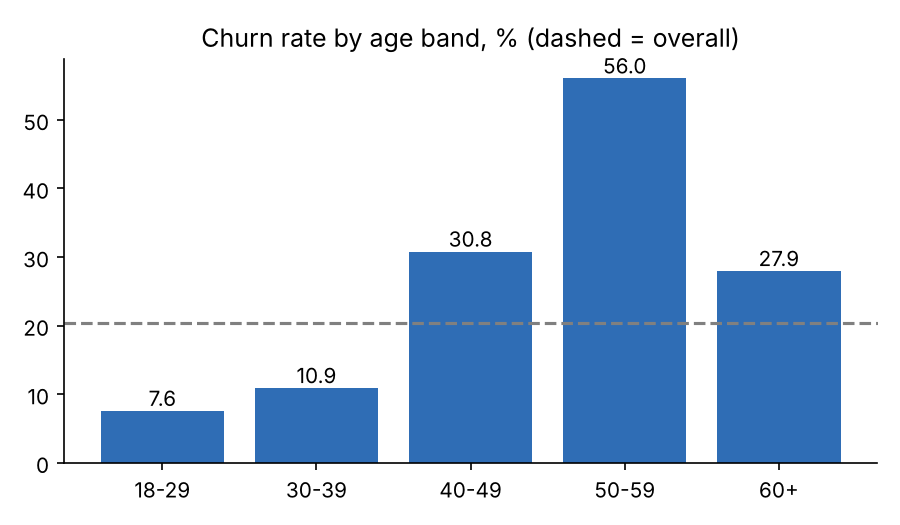
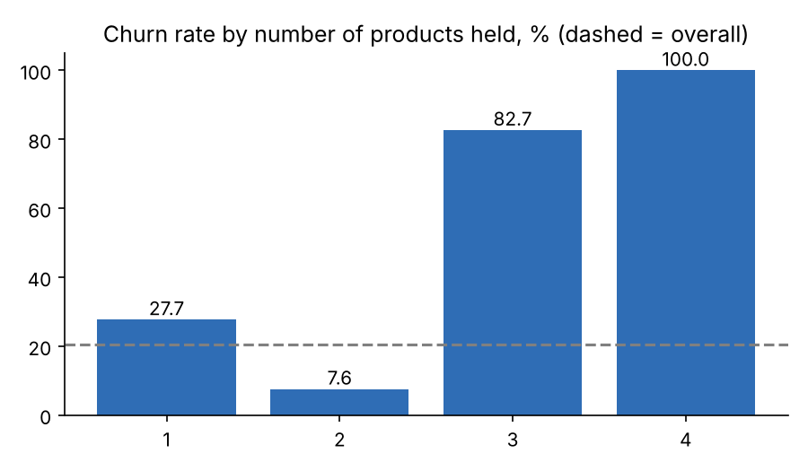
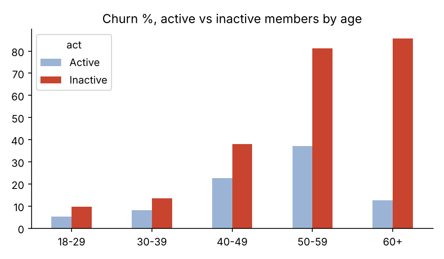

# Bank customer churn analysis

**Business question:** Which retail-bank customers are leaving, what signals predict it, and how much of the deposit base is at risk?

**Data:** Bank Customer Churn ("Churn_Modelling"), 10,000 customers, public on Kaggle/GitHub. Columns used: CreditScore, Age, Tenure, Balance, NumOfProducts, HasCrCard, IsActiveMember, EstimatedSalary, Exited (churn flag).
**Tools:** SQL (DuckDB: `CASE WHEN` bucketing, aggregates, subqueries), Python (pandas, SciPy, statsmodels, matplotlib).

## How to run
Download `Churn_Modelling.csv` (Bank Customer Churn, 10,000 rows, also on [Kaggle](https://www.kaggle.com/datasets/shrutimechlearn/churn-modelling)) into a `data/` folder and `pip install -r requirements.txt`. This analysis used the copy from [Shavez18/Customer-Churn-prediction](https://github.com/Shavez18/Customer-Churn-prediction), which has the 9 columns listed above.

`sql/01_churn_analysis.sql` in DuckDB, then `python stats_tests.py data/Churn_Modelling.csv` and `python charts.py data/Churn_Modelling.csv`.

## Data quality checks
10,000 rows, no nulls in key fields, ages 18-92 and credit scores 350-850 are plausible. 3,617 customers (36%) have a zero balance: kept, but analysed as their own band.

## Charts

## Findings
1. **Overall churn is 20.4%** (2,037 of 10,000).
2. **Inactive members churn almost twice as much:** 26.9% vs 14.3%. Chi-square p < 0.001. Holding other factors fixed, active members have 67% lower odds of churning (logistic regression odds ratio 0.33).
3. **Age is the strongest single signal:** churners average 44.8 years vs 37.4 for retained (Welch t-test, p < 0.001). The 50-59 band churns at 56%.
4. **Product count is non-linear:** 2 products = 7.6% churn, 1 product = 27.7%, 3+ products = 82.7-100% (small group, 326 customers). Holding 3+ products likely signals a problem (forced bundling or complaints), not loyalty.
5. **Money at risk:** churners held 24.3% of all balances. Higher-balance customers churn more (25.2% for 100k+ vs 13.8% for zero balance).
6. **One rule finds 41% of churners:** inactive customers aged 40-59 are 17.7% of the base (1,769) but 40.9% of all churners, with a 47.1% churn rate.

## Recommendations
1. Build an early-warning list: inactive + age 40-59 → relationship-manager outreach.
2. Push single-product customers to a second product (2-product churn is 7.6%).
3. Investigate 3+ product customers for mis-selling or service issues.

## Limitations
This version has no geography or gender columns and no time dimension, so it shows who churned, not when. Logistic regression is used to explain drivers, not to deploy a prediction model.
